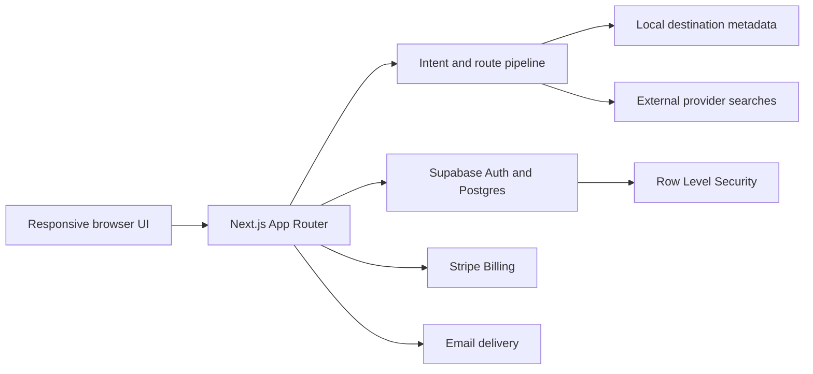

# Wild Route

Wild Route turns a rough adventure idea into ranked, shareable multi-stop
routes with visible reasoning, planning estimates, and external booking
handoffs.

It is a responsive product-engineering project built with Next.js, TypeScript,
Supabase, and Stripe. The core route engine is deterministic today: the
interface uses AI-assisted product patterns, but it does not pretend that local
scoring is live model or provider intelligence.

## The Product Problem

Independent travelers often assemble one route across maps, destination lists,
flight searches, notes, and group chats. Wild Route combines the early
decision-making loop:

1. Describe the trip and practical constraints.
2. Compare ranked route options and their trade-offs.
3. Inspect the itinerary with a globe or accessible map/list fallback.
4. Save a route, publish a stable public snapshot, and share it.
5. Continue to external providers for final price and availability.

Wild Route is planning support, not a travel agency or booking engine. It does
not guarantee price, availability, safety, weather, visa eligibility, or route
feasibility.

## What The Repository Proves

- A prompt-first planner with structured intent parsing and deterministic route ranking
- A distinctive responsive interface with loading, error, empty, reduced-motion, and map fallback behavior
- Same-origin App Router APIs with Zod request validation
- Server-enforced generation, saved-route, and promoted-stop entitlements
- Supabase Auth, Postgres migrations, and owner-scoped RLS policies
- Durable generation, save, publish, public share, handoff, profile, export, and deletion paths when Supabase is configured
- Stripe checkout, billing portal, signature-verified webhook handling, and entitlement synchronization
- Safe public route snapshots that omit owner, generation, booking-link, and provider-internal fields
- Deterministic fallback mode for local product exploration without paid or hosted services
- Automated coverage for route generation, API validation, ownership, public-share hardening, billing, webhooks, health checks, profiles, and planner persistence

## Real, Fallback, And Unverified Behavior

| Surface | Current state |
| --- | --- |
| Route interpretation and ranking | Real deterministic TypeScript logic using local destination fixtures |
| Price and confidence | Wild Route planning estimates, not provider-confirmed inventory |
| Booking links | Real external searches; the provider owns final price and availability |
| Supabase auth and persistence | Implemented and environment-gated; local demo mode uses process memory |
| Public shares | Durable with Supabase; session-local in demo mode |
| Stripe billing | Implemented with automated route/webhook tests; live test-mode execution is not yet recorded in this repository |
| Email | Optional Resend-compatible delivery with graceful fallback |
| Live travel providers | Not implemented; adapter and freshness hardening are planned |
| Live AI model | Not implemented; deterministic behavior remains the tested default |
| Deployment | [Live transparent demo](https://ai-travel-planner-psi-five.vercel.app); managed services are disabled and unverified |

This distinction is intentional. Missing services degrade to explicit fixture
or memory behavior instead of being presented as production persistence.

## Architecture



Key boundaries:

- React components own rendering and interaction; domain decisions live in `lib`.
- Browser clients call same-origin route handlers and never receive service-role,
  Stripe, webhook, email, or provider secrets.
- User-owned database rows remain behind RLS and server-side ownership checks.
- Public shares are read server-side and passed through an explicit whitelist
  before rendering.
- Provider-specific data belongs behind adapters rather than UI components.
- Generated routes expose assumptions, confidence, freshness status, and
  external-handoff disclaimers.

See [Architecture](docs/ARCHITECTURE.md),
[API contracts](docs/API_SPEC.md), and
[Database schema](docs/DATABASE_SCHEMA.md) for the detailed design.

## Portfolio Evidence

- [Product engineering case study](docs/CASE_STUDY.md)
- [Five-minute demo walkthrough](docs/DEMO_WALKTHROUGH.md)
- [Architecture and trust boundaries](docs/ARCHITECTURE.md#trust-boundaries)
- [Unfinished surfaces audit](docs/UNFINISHED_SURFACES_AUDIT.md)
- [Deployment and known-limitations record](docs/DEPLOYMENT.md)
- [Browser QA evidence](docs/BROWSER_QA.md)

## Stack

- Next.js 15 App Router, React 19, and TypeScript
- Supabase Auth, Postgres, and Row Level Security
- Stripe Checkout, Billing Portal, and webhooks
- Zod validation
- Vitest and Testing Library
- GSAP, Three.js, and `react-globe.gl`
- Resend-compatible transactional email

## Run Locally

Requirements:

- Node.js 20.19 or newer (`.nvmrc` selects Node.js 22.13.1)
- npm

```bash
npm install
cp .env.example .env.local
npm run dev
```

Open `http://localhost:3000`. The product remains explorable without hosted
services; use demo mode for session-local save and share behavior.

To exercise managed persistence and billing, configure the relevant values in
`.env.local`:

```dotenv
NEXT_PUBLIC_APP_URL=http://localhost:3000

NEXT_PUBLIC_SUPABASE_URL=
NEXT_PUBLIC_SUPABASE_PUBLISHABLE_KEY=
SUPABASE_SERVICE_ROLE_KEY=

STRIPE_SECRET_KEY=
STRIPE_WEBHOOK_SECRET=
STRIPE_PRO_PRICE_ID=

RESEND_API_KEY=
EMAIL_FROM=
```

Apply the SQL files in [supabase/migrations](supabase/migrations) in
chronological order. Supabase OAuth providers and Stripe webhook delivery also
require configuration in their respective dashboards.

## Quality Checks

```bash
npm run verify:migrations
npm run verify:services
npm run lint
npm run test
npm run test:e2e
npm run build
npm audit --omit=dev
```

Baseline verified on 2026-08-01:

- 15 Vitest files and 71 passing tests
- 15 passing Chromium accessibility, golden-path, and media-failure tests
- 5 statically verified Supabase migration files
- successful Next.js 15.5.22 production build
- zero known production dependency vulnerabilities in `npm audit --omit=dev`

Live Stripe checkout and portal verification follows the
[Stripe test-mode QA checklist](docs/STRIPE_TEST_MODE_QA.md).

## Repository Guide

- [Product specification](docs/PRODUCT_SPEC.md)
- [Master execution roadmap](docs/MASTER_EXECUTION_ROADMAP.md)
- [Project accelerator](docs/PROJECT_ACCELERATOR.md)
- [Portfolio upgrade roadmap](docs/PORTFOLIO_UPGRADE_ROADMAP.md)
- [Design system](docs/DESIGN_SYSTEM.md)
- [AI and route-generation rules](docs/AI_AND_ROUTE_GENERATION.md)
- [Security, privacy, and compliance](docs/SECURITY_PRIVACY_AND_COMPLIANCE.md)
- [Testing strategy](docs/TESTING_STRATEGY.md)
- [Environment setup](docs/ENVIRONMENT.md)
- [Implementation process](docs/IMPLEMENTATION_PROCESS.md)

## Known Limitations

- Destination metadata and route scoring are fixture-backed.
- There is no provider-confirmed flight, stay, weather, map, or advisory data.
- Demo accounts and their routes are not durable across server restarts.
- Newsletter signup preferences use demo memory; email delivery is optional and
  does not make the subscriber list durable.
- Stripe test-mode checkout and portal still need recorded live verification.
- Browser automation currently targets Chromium; manual screen-reader and
  broader browser coverage remain launch checks.
- Abuse limiting is per application instance until a distributed adapter or
  edge control is configured.
- Operational events are privacy-safe structured logs, but a production sink
  and alert policy are not configured in this repository.

The next work is tracked in the
[portfolio upgrade roadmap](docs/PORTFOLIO_UPGRADE_ROADMAP.md) and the
[product roadmap](docs/MASTER_EXECUTION_ROADMAP.md).
