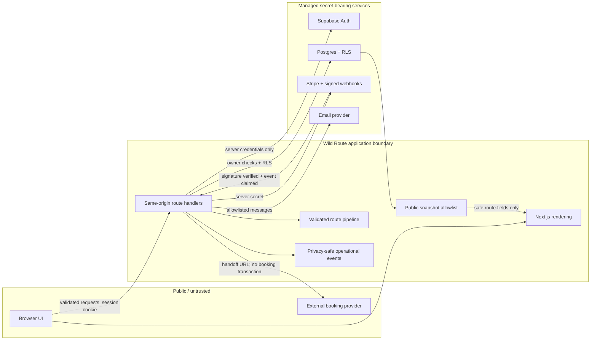
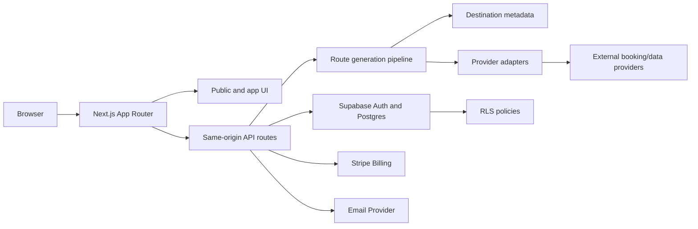

# Architecture

## System Boundary
Wild Route is a travel route discovery and planning application. It separates UI, route generation, auth, persistence, billing, email, and external handoffs so the product can mature without mixing provider details into presentation code.

## High-Level Components

| Component | Responsibility |
| --- | --- |
| Next.js App Router | Marketing pages, app UI, route handlers, auth-aware server actions/BFF behavior, Stripe webhook, rendering |
| Supabase Auth | User identity, sessions, OAuth and magic-link login |
| Supabase Postgres | Route generations, saved routes, public shares, booking handoffs, profiles, entitlements, newsletter data |
| Supabase RLS | User-owned data isolation |
| Stripe | Checkout, portal, subscriptions, entitlement events |
| Resend-compatible email | Newsletters and route/account notifications |
| Provider adapters | Booking links, future flights/stays/maps/weather/advisory data |
| Route generation pipeline | Intent parsing, candidate expansion, scoring, entitlement enforcement, snapshot persistence |

## Trust Boundaries



Boundary rules:

- The browser is untrusted. It never receives a Supabase service-role key,
  Stripe secret, webhook secret, email key, or future provider credential.
- Every API input is parsed before domain or persistence work. Authenticated
  identity comes from the session, never a client-submitted owner ID.
- RLS and server-side ownership checks protect user data. Public share pages
  receive only an explicit safe snapshot, not a database row.
- Stripe event signatures are verified before a service-only replay ledger
  claims the event and permits entitlement work.
- Operational events accept an allowlist of low-cardinality fields and
  pseudonymous identifiers; prompts, emails, route details, billing IDs, raw
  errors, and provider payloads stay out.
- External links are booking handoffs. Wild Route does not accept travel
  payment or assert final price and availability.

## System Diagram



## Request Flow
1. Browser renders public pages or authenticated app pages through Next.js.
2. Supabase Auth manages session cookies.
3. Planner form posts to `POST /api/trips/plan`.
4. Server validates input and interprets prompt into `TripIntent`.
5. Route generation selects candidates, scores routes, enforces entitlement limits, and builds booking links.
6. Generation snapshots are persisted when Supabase is configured; deterministic fallback is allowed only where explicitly documented.
7. Save/publish/handoff APIs require ownership checks and durable route IDs.
8. Stripe webhook updates entitlements after verified subscription events.

## Repository Shape

```txt
app/                    Next.js routes, pages, route handlers
components/             Shared UI components and planner components
lib/                    Domain, auth, Supabase, billing, email, planner logic
supabase/migrations/    SQL migrations and RLS policies
public/                 Brand and editorial assets
docs/                   Source-of-truth process and architecture docs
ai-dev/skills/          Repo-local AI work-routing skills
```

## Runtime Principles
- Keep domain logic in `lib`, not embedded in React components.
- Keep provider-specific details behind adapter modules.
- Keep auth and ownership checks server-side.
- Keep Supabase service role usage server-only.
- Make optional integrations fail closed for private data and fail soft for public UX.
- Prefer durable snapshots for generated routes so public shares do not mutate unexpectedly.

## Deployment Direction
- Web app: Vercel or equivalent Next.js hosting.
- Database/auth: Supabase.
- Billing: Stripe.
- Email: Resend-compatible provider.
- Future cache/rate limit: Upstash or provider-native equivalent.

## Architecture Non-Goals
- Separate custom backend service for v1 unless provider/data complexity requires it.
- Client-side direct database writes for protected resources.
- Long-running route jobs without a queue strategy.
- Model calls directly reading private database data.
