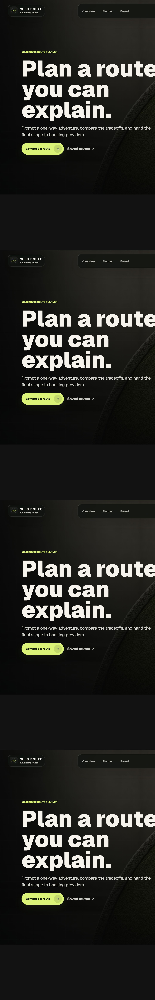
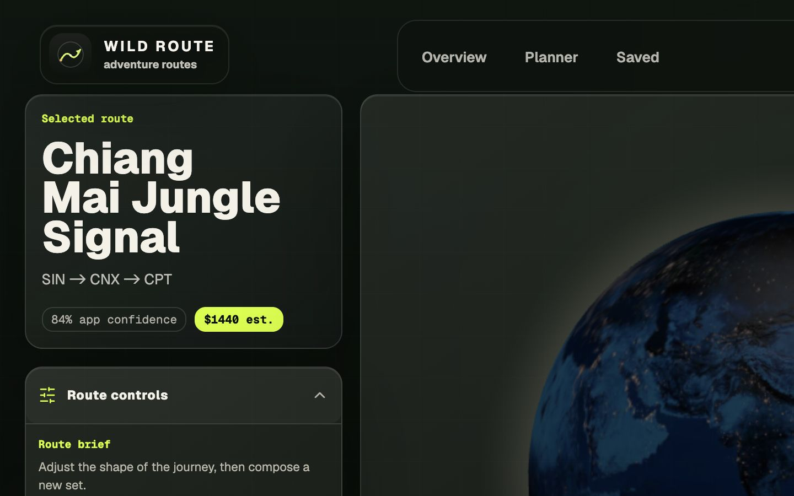
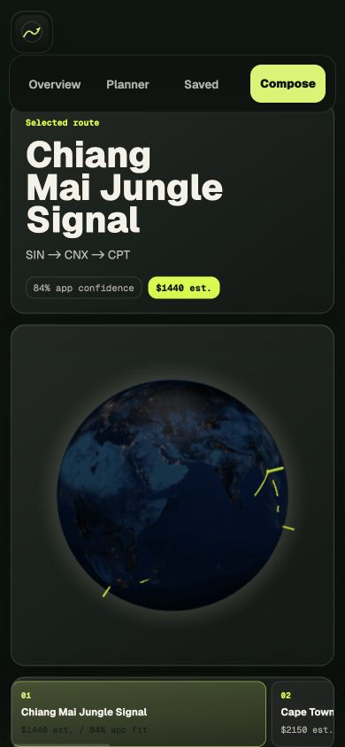
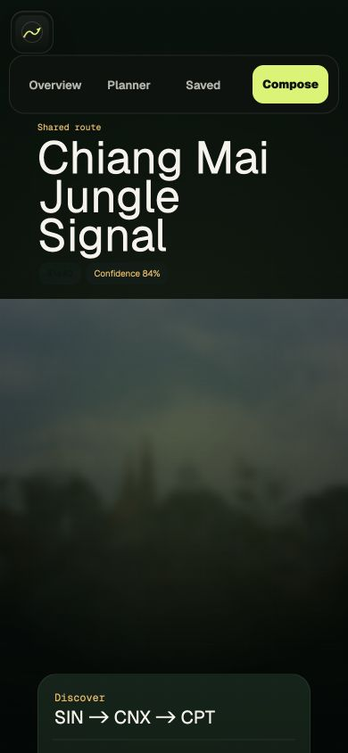

# Portfolio Screenshots

Captured from the verified production deployment on 2026-08-01. These images
are unretouched browser captures from
https://ai-travel-planner-psi-five.vercel.app.

## Desktop Homepage

Full page, 1440 px wide.

## Desktop Planner

Planner workspace at a 1440 × 900 viewport with the default Singapore route.

## Mobile Planner

Planner workspace at 390 × 844. The route summary, globe/fallback layer, and
ranked route dock remain usable at the mobile breakpoint.

## Mobile Public Share

Stateless demo share at 390 × 844. The route title, estimate boundary, imagery,
and journey panels preserve the editorial direction on mobile.

## Capture Notes

- The screenshots use the fixture-backed Singapore demo route.
- Displayed costs are planning estimates and confidence is app-defined.
- The production project had no Supabase, Stripe, email, provider, or model
  variables configured during capture.
- Remote media retains the bundled fallback behavior verified by browser tests.
